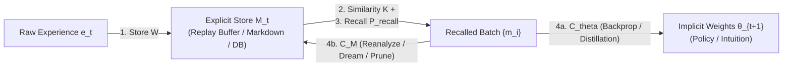

# A Unified Theory of Agentic Memory — Bearblog Reference Notes

> [!NOTE]
> **Central Thesis:** The LLM engineering world (RAG, vector DBs, `CLAUDE.md` / `AGENTS.md` files) and the Deep RL / ML world (experience replay buffers, Prioritized Experience Replay, backpropagation) are solving the exact same problem on different substrates. Both can be unified under a single algebraic interface over a coupled **Explicit–Implicit** state space—and writing down that unification immediately exposes a "missing quadrant" in both fields.

---

## 1. Original Seed Notes

```text
On memory and agents
Memory is in the abstract a few things:
- a way to store past experiences in whatever medium the agent uses
- A similarity function to measure if memory A is similar or different to memory B
- A method to recall or replay memories
- A method to update, reflect on, or delete memories
Memory can be explicit or implicit in practice:
- explicit: a replay buffer, organized markdown files, a database
- Implicit: model weights
Trauma / Spiked Information Gain: memories where information gain is high, spiked
Eval implementations based on these abstract concepts: how well can it recall the correct memories, does it leverage or prioritize important memories
```

---

## 2. The Coupled Agent State: Explicit vs. Implicit Memory

Instead of viewing an agent purely through its fixed policy parameters $\pi_\theta(a \mid s)$, we define an agent's complete cognitive state at time $t$ as a coupled pair:

$$\Psi_t = \big(\theta_t, \, M_t\big)$$

| Dimension | Implicit Memory ($\theta_t \in \Theta$) | Explicit Memory ($M_t \in \mathcal{M}$) |
| :--- | :--- | :--- |
| **Biological Analog** | Neocortex (synaptic weights, procedural/semantic) | Hippocampus (episodic traces) |
| **RL Realization** | Policy, Value, & World Model weights $\theta$ | Experience Replay Buffer $\mathcal{D}$ |
| **LLM Realization** | Pre-trained / fine-tuned Transformer weights | Markdown files (`.md`), Vector DBs, session logs |
| **Write Speed** | Slow ($O(\text{steps})$ via gradient descent) | Instant ($O(1)$ append) |
| **Read / Inference Cost** | $O(1)$ forward pass (zero search overhead) | $O(|M_t|)$ retrieval / context injection |
| **Failure Mode** | Catastrophic forgetting (stability–plasticity dilemma) | Unbounded capacity growth, retrieval noise, zero compression |

Each explicit memory entry $m_i \in M_t$ is a 3-tuple:

$$m_i = \big(k_i, \, v_i, \, p_i\big)$$

where:
- $k_i = \phi(e_i)$ is an indexable key representation of raw experience $e_i$,
- $v_i$ is the stored payload (e.g., transition $(s_t, a_t, r_t, s_{t+1})$ or text chunk),
- $p_i \in \mathbb{R}^+$ is its **salience / priority** score (information gain).



---

## 3. The Four Algebraic Operators of Memory

Every memory system $\mathcal{M}$ is defined by four primitive operators acting on $\Psi_t = (\theta_t, M_t)$:

### 3.1 Store ($\mathcal{W}$ — Write / Encode)

$$\mathcal{W}(M_t, e_t) = M_t \cup \Big\{\big(\phi(e_t), \, e_t, \, p_0(e_t)\big)\Big\}$$

Encodes a raw environmental interaction $e_t$ into the explicit medium with initial salience $p_0(e_t)$.

### 3.2 Similarity ($\mathcal{K}$ — Metric Kernel)

$$\mathcal{K}: \mathcal{X} \times \mathcal{X} \to \mathbb{R}$$

Measures structural proximity between a query state $q_t$ (or another memory $k_j$) and memory key $k_i$:
- **Vector RAG / Embeddings:** Cosine similarity $\mathcal{K}(q, k_i) = \frac{\langle q, k_i \rangle}{\|q\|\|k_i\|}$.
- **Episodic RL / World Models:** Negative latent distance $\mathcal{K}(q, k_i) = -\|h_\theta(q) - h_\theta(k_i)\|_2$.
- **Structured Markdown:** Tag, directory, or entity graph overlap.

### 3.3 Recall / Replay ($P_{\text{recall}}$)

#### In Plain English: The Two Questions of Recall
When you are in the middle of a task ($q_t$) and try to recall a useful past memory ($m_i$), what determines which memory pops into your head? Intuitively, every recall system is just balancing **two simple questions**:
1. **Relevance ($\mathcal{K}(q_t, k_i)$): *"How similar is this memory to what I'm looking at right now?"***
   If you are debugging a C++ segfault, you want memories of past segfaults—not what you had for breakfast.
2. **Surprise / Importance ($p_i$): *"How big of a deal was this memory when it happened?"***
   A hundred mundane, predictable turns fade into the background, whereas touching a hot stove or discovering a 10x speedup sticks at the top of your mind.

You can think of an agent's recall system as scoring every memory by adding those two factors together, using two **"volume knobs" (sliders)**—$\beta_{\text{sim}}$ (how much the agent cares about *Relevance*) and $\beta_{\text{sal}}$ (how much it cares about *Surprise*):

$$\text{Score}(m_i \mid q_t) = \underbrace{\beta_{\text{sim}} \cdot \mathcal{K}(q_t, k_i)}_{\text{Relevance Knob } \times \text{ Similarity}} + \underbrace{\beta_{\text{sal}} \cdot \log p_i}_{\text{Surprise Knob } \times \text{ Importance}}$$

#### The Formal Equation
To turn those scores into a valid probability distribution (so all probabilities sum to $1$), we pass them through a standard softmax:

$$P_{\text{recall}}(m_i \mid q_t, M_t) = \frac{\exp\!\Big(\beta_{\text{sim}} \, \mathcal{K}(q_t, k_i) + \beta_{\text{sal}} \log p_i\Big)}{\sum_{j=1}^{|M_t|} \exp\!\Big(\beta_{\text{sim}} \, \mathcal{K}(q_t, k_j) + \beta_{\text{sal}} \log p_j\Big)}$$

Why is this equation so useful? Because simply turning those two volume knobs $(\beta_{\text{sim}}, \beta_{\text{sal}})$ on or off recovers every major memory algorithm in RL and LLMs as a special case:

1. **Both knobs at 0 ($\beta_{\text{sim}} = 0, \, \beta_{\text{sal}} = 0$) $\implies$ Uniform Experience Replay (Vanilla DQN):**
   Every memory gets the exact same score ($e^0 = 1$), so $P_{\text{recall}}(m_i) = \frac{1}{|M_t|}$. The agent is just pulling past experiences out of a hat completely at random.
2. **Only the Surprise knob turned up ($\beta_{\text{sim}} = 0, \, \beta_{\text{sal}} = \alpha$) $\implies$ Prioritized Experience Replay (PER):**
   Because $\exp(\alpha \log p_i) = p_i^\alpha$, this simplifies directly to $P_{\text{recall}}(m_i) = \frac{p_i^\alpha}{\sum_j p_j^\alpha}$. The agent doesn't filter by its current state; during training, it just replays its biggest shocks and breakthroughs over and over.
3. **Only the Relevance knob turned up ($\beta_{\text{sim}} > 0, \, \beta_{\text{sal}} = 0$) $\implies$ Standard LLM RAG / Vector Search:**
   The agent fetches the closest keyword or embedding matches to the current prompt, but is completely blind to whether those memories actually contain a high-surprise lesson or just mundane chatter.
4. **Both knobs turned up ($\beta_{\text{sim}} > 0, \, \beta_{\text{sal}} > 0$) $\implies$ Full Agentic Recall:**
   The agent surfaces memories that are **both** relevant to the problem right in front of it *and* packed with high information gain.

---

## 4. The Consolidation Operator ($\mathcal{C}$)

Consolidation is the mechanism that updates, reflects on, compresses, or deletes memories:

$$\big(\theta_{t+1}, \, M_{t+1}\big) = \mathcal{C}(\theta_t, \, M_t) = \Big( \underbrace{\mathcal{C}_{\theta}(\theta_t, M_t)}_{\text{Explicit} \to \text{Implicit}}, \;\; \underbrace{\mathcal{C}_{M}(M_t; \theta_{t+1})}_{\text{Explicit} \to \text{Explicit}} \Big)$$

### Pathway A: Explicit $\to$ Implicit Consolidation ($\mathcal{C}_{\theta}$ — Backpropagation)

$$\theta_{t+1} = \theta_t - \eta \, \mathbb{E}_{m_i \sim P_{\text{recall}}(M_t)} \Big[ w_i \, \nabla_\theta \mathcal{L}(\theta_t; m_i) \Big]$$

- **Deep RL:** Replaying transitions from the buffer to update policy/value network weights $\theta$.
- **Supervised Learning & LLM Pre-Training / SFT:** The training dataset on disk *is* an explicit memory store $M_t$. Backpropagation is the consolidation operator that compresses terabytes of explicit records into fixed-size implicit weights $\theta$ (after which the raw dataset $M_t$ can be discarded).
- **Surprise-Driven Gradients:** Even under uniform sampling ($w_i = 1$), standard cross-entropy loss $\mathcal{L}(\theta; x) = -\log P_\theta(x)$ yields zero gradient when $P_\theta(x) \to 1$ (expected outcome) and a spiked gradient when $P_\theta(x) \ll 1$ (high surprise).

### Pathway B: Explicit $\to$ Explicit Consolidation ($\mathcal{C}_{M}$ — Reflection, Reanalyze, & Pruning)

When weights $\theta$ are frozen (inference-time LLM agents) or between training phases, consolidation reorganizes $M_t$ directly via three composite operations:

$$\mathcal{C}_{M}(M_t; \theta_{t+1}) = \big(\text{Prune} \circ \text{Compress} \circ \text{Re-evaluate}\big)(M_t)$$

1. **Re-evaluate (`update` individual memories):**
   $$v_i' \leftarrow f_{\text{relabel}}(v_i, \theta_{t+1}), \qquad p_i' \leftarrow \mathcal{I}(v_i'; \theta_{t+1})$$
   - *RL:* **MuZero Reanalyze**—re-running MCTS over old buffer trajectories using newer network weights $\theta_{t+1}$ to sharpen targets and refresh TD-error priorities $p_i'$.
   - *LLM Agents:* Re-scoring or updating stored notes when new evidence arrives.
2. **Semantic Compression (`reflect` across clusters):**
   $$\big\{m_1, m_2, \dots, m_k\big\} \xrightarrow{\;\;g_{\text{compress}}\;\;} \hat{m} = (\hat{k}, \hat{v}, \hat{p})$$
   Optimizes an **Information Bottleneck** objective: minimizing description length $|\hat{v}| \ll \sum_i |v_i|$ while preserving mutual information with future returns $Y$:
   $$\max_{\hat{m}} \; I(\hat{m}; Y) - \beta \, |\hat{m}|$$
   - *LLM Agents:* "Dreaming" / compaction—distilling 100 raw transcript turns into a 2-sentence rule in `AGENTS.md`.
   - *System Prompt Files as Pseudo-Weights:* For a frozen-weight LLM, a pinned file like `AGENTS.md` ($p_i = \infty$) sits at the boundary of Explicit and Implicit memory: physically stored as text in $M_t$, but functionally conditioning $\pi_\theta(a \mid s, M_{\text{pinned}})$ on every forward pass like a weight update.
3. **Eviction / Garbage Collection (`delete`):**
   $$M_{t+1} = \Big\{ m_i \in M_t' \;\Big|\; p_i' > \tau_{\text{min}} \Big\}$$
   Deletes memories whose information gain has decayed below $\tau_{\text{min}}$ or been absorbed into $\theta_{t+1}$ / $\hat{m}$.

---

## 5. Spiked Information Gain ("Trauma" & Breakthroughs)

If an agent stores and replays every experience uniformly, it wastes most of its compute rehearsing predictable transitions where its world model was already right. What makes a memory worth prioritizing is **spiked information gain**.

### 5.1 Exact Formulation: Bayesian Surprise

Given prior belief $P(\theta \mid \mathcal{H}_{t-1})$ over world/policy parameters before observing $e_t$, and posterior $P(\theta \mid \mathcal{H}_{t-1}, e_t)$ after observing $e_t$, the information gain is the Kullback–Leibler divergence:

$$\mathcal{I}(e_t) = D_{\text{KL}}\Big( P(\theta \mid \mathcal{H}_{t-1}, e_t) \;\Big\|\; P(\theta \mid \mathcal{H}_{t-1}) \Big)$$

### 5.2 Tractable RL Realization: TD-Error & Advantage

Because exact Bayesian posteriors over neural weights are intractable, RL agents approximate $\mathcal{I}(e_t)$ via the magnitude of **Temporal-Difference (TD) prediction error** $\delta_t$ (or Advantage $A_t$):

$$\delta_t = A_t = \underbrace{\big(r_t + \gamma V_{\theta_t}(s_{t+1})\big)}_{\text{Reality}} - \underbrace{V_{\theta_t}(s_t)}_{\text{Agent's Expectation}}, \qquad p_t = |\delta_t| + \epsilon$$

This is symmetric across both directions of surprise:
- **Positive Spike ($A_t \gg 0$ — Breakthrough):** The agent discovered a trajectory far better than its value network thought possible.
- **Negative Spike ($A_t \ll 0$ — Catastrophe / "Trauma"):** The agent entered a state with high confidence ($V_\theta(s_t) \gg 0$) and hit a hidden wall or failure.

---

## 6. Putting the Framework to Use: The "Missing Quadrant" & Asymptotic Handoff

Viewing agents through $\Psi_t = (\theta_t, M_t)$ exposes a striking asymmetry between Deep RL and LLM agents:
- **Standard Deep RL** uses Explicit Memory ($M_t$) *only* during training ($\mathcal{C}_\theta$), and ignores it at runtime—relying $100\%$ on slow implicit weights $\theta_t$ when selecting actions. As a result, an RL agent will step into the exact same trap 15–20 times in a row while waiting for small gradient updates to shift its policy logits.
- **Standard LLM Agents** use Explicit Memory ($M_t$) *only* at runtime ($P_{\text{recall}}$), while keeping Implicit Memory ($\theta_t$) frozen forever.

### 6.1 Why Naive Injection Double-Counts, and Which Term Must Be Injected

Suppose the agent is at state $s$ considering action $a$ (e.g., stepping `RIGHT` into a $-10$ Lava Trap).
- Let $z_{\theta_t}(s, a)$ be the **implicit neural network's predicted action value (logit)** after $t$ consolidation steps, initialized with an optimistic prior $z_{\theta_0}(s, a) = +2$.
- On Episode 1, the agent takes action $a$ and observes the true outcome $G = -10$ (so the required total shift from its initial prior $+2$ to reality $-10$ is $-12$).

If we form a runtime composite logit $z_{\text{total}}(s, a) = z_{\theta_t}(s, a) + \text{ExplicitTerm}_t(s, a)$:
1. **Why fixed reward ($G = -10$) or state-value Advantage ($A(s, a) = G(s, a) - V_{\theta_t}(s)$) fails:**
   - By Episode 50, backpropagation has *already* updated the implicit network to $z_{\theta_{50}}(s, a) = -10$. If the buffer still adds $-12$ on top, $z_{\text{total}} = -10 + (-12) = -22$ (**double-counting**).
   - Standard Advantage $A(s, a) = G(s, a) - V_{\theta_t}(s)$ does **not** decay to $0$ either, because $V_{\theta_t}(s)$ converges to the value of the *best* action at state $s$ (the $+8$ safe detour), not the trap action! Thus $A^*(s, a_{\text{trap}}) = -10 - 8 = -18 \neq 0$ forever.
2. **The Correct Term — Action Prediction Residual $\delta(s, a; \theta_t)$:**
   What does the explicit memory $M_t$ know that the implicit network $z_{\theta_t}(s, a)$ hasn't learned *yet*? The exact gap between the **true outcome $G$ stored in $M_t$** and the **current implicit prediction $z_{\theta_t}(s, a)$**:
   $$\delta(s, a; \theta_t) = \underbrace{G}_{\text{Reality in } M_t} - \underbrace{z_{\theta_t}(s, a)}_{\text{What } \theta_t \text{ Already Knows}}$$
   Injecting this residual into the runtime policy decomposes the true action value into what is already consolidated into $\theta_t$ plus what is still waiting in $M_t$:
   $$z_{\text{total}}(s, a; \Psi_t) = \underbrace{z_{\theta_t}(s, a)}_{\text{Implicit }(\theta_t)} + \; \lambda \sum_{m_i \in M_t(a)} P_{\text{recall}}(m_i \mid s, M_t) \cdot \underbrace{\big(G_i - z_{\theta_t}(s, a)\big)}_{\text{Explicit Residual }\delta_i(\theta_t)}$$

### 6.2 Full Step-by-Step Derivation of the Asymptotic Handoff ($t = 0 \to \infty$)

Let $z_{\theta_0}$ be the initial implicit logit at $t=0$, $G$ be the observed outcome, and $\delta_0 = G - z_{\theta_0}$ be the initial shock on Episode 1. At each consolidation step $t \to t+1$, we replay the memory from $M_t$ and take one gradient step on $\mathcal{L}(\theta_t) = \frac{1}{2}(G - z_{\theta_t})^2$ with learning rate $\eta \in (0, 1)$:

$$z_{\theta_{t+1}} = z_{\theta_t} + \eta \, \delta_t$$

#### Step A: Evolution of the Explicit Residual $\delta_t$
Substituting the weight update into $\delta_{t+1} = G - z_{\theta_{t+1}}$:
$$\begin{aligned}
\delta_{t+1} &= G - \big(z_{\theta_t} + \eta \, \delta_t\big) \\
&= \underbrace{(G - z_{\theta_t})}_{\delta_t} - \eta \, \delta_t \\
&= (1 - \eta) \, \delta_t
\end{aligned}$$
Unrolling from step $0$ to step $t$ gives the **Explicit Memory Curve**:
$$\boxed{\delta_t = (1 - \eta)^t \, \delta_0}$$
Since $0 < \eta < 1$, $\lim_{t \to \infty} \delta_t = 0$.

#### Step B: Evolution of the Implicit Weight Shift $\Delta z_{\theta_t}$
The cumulative shift in the implicit weight from its initial prior $z_{\theta_0}$ after $t$ steps is the geometric series of all gradient updates:
$$\begin{aligned}
\Delta z_{\theta_t} &= z_{\theta_t} - z_{\theta_0} = \sum_{k=0}^{t-1} \eta \, \delta_k = \eta \, \delta_0 \sum_{k=0}^{t-1} (1 - \eta)^k \\
&= \eta \, \delta_0 \cdot \frac{1 - (1 - \eta)^t}{1 - (1 - \eta)}
\end{aligned}$$
Canceling $\eta$ in the numerator and denominator yields the **Implicit Weight Shift Curve**:
$$\boxed{\Delta z_{\theta_t} = \Big(1 - (1 - \eta)^t\Big) \, \delta_0}$$
As $t \to \infty$, $\lim_{t \to \infty} \Delta z_{\theta_t} = \delta_0$.

#### Step C: The Conservation Law
For $\lambda = 1$, adding the Implicit Weight Shift and the Explicit Residual at any step $t \ge 0$ gives an exact invariant:
$$\Delta z_{\text{total}}(t) = \underbrace{\Big(1 - (1 - \eta)^t\Big) \delta_0}_{\text{Implicit Shift }\Delta z_{\theta_t}} + \underbrace{(1 - \eta)^t \delta_0}_{\text{Explicit Residual }\delta_t} = \delta_0$$

| Consolidation Step $t$ | Explicit Surprise $\delta_t = 0.9^t(-12)$ *(Orange Curve)* | Implicit Weight Shift $\Delta z_{\theta_t} = (1 - 0.9^t)(-12)$ *(Green Curve)* | Total Applied Shift $\Delta z_{\text{total}}$ *(Dotted Line)* | Who Drives the Decision? |
| :--- | :--- | :--- | :--- | :--- |
| **$t = 0$ (Ep 1 shock)** | **$-12.00$** ($100\%$) | **$0.00$** ($0\%$) | $-12.00$ | $100\%$ Explicit Memory ($M_t$) |
| **$t = 1$ (After 1 update)** | **$-10.80$** ($90\%$) | **$-1.20$** ($10\%$) | $-12.00$ | $90\%$ Explicit / $10\%$ Implicit |
| **$t = 7$ (After 7 updates)** | **$-5.74$** ($48\%$) | **$-6.26$** ($52\%$) | $-12.00$ | Crossover point ($50/50$) |
| **$t = 25$** | **$-0.86$** ($7\%$) | **$-11.14$** ($93\%$) | $-12.00$ | Mostly Implicit Weights ($\theta_t$) |
| **$t \to \infty$** | **$0.00$** ($0\%$) | **$-12.00$** ($100\%$) | $-12.00$ | $100\%$ Implicit Weights (Buffer entry can be pruned!) |


### 6.3 Algebraic Equivalence to DeepMind's *Episodic Control* & *Fast and Slow RL*

Letting $Q_{\text{explicit}}(s, a) = \sum_{m_i \in M_t(a)} P_{\text{recall}}(m_i \mid s) \, G_i$ denote the recalled empirical return from the buffer, look at what happens when we expand our residual injection equation:

$$\begin{aligned}
z_{\text{total}}(s, a) &= z_{\theta_t}(s, a) + \lambda \Big( Q_{\text{explicit}}(s, a) - z_{\theta_t}(s, a) \Big) \\[4pt]
&= (1 - \lambda) \, z_{\theta_t}(s, a) + \lambda \, Q_{\text{explicit}}(s, a)
\end{aligned}$$

This shows that **injecting the action prediction residual $\lambda \delta(s, a; \theta_t)$ is algebraically equivalent to a convex interpolation between slow parametric weights $z_{\theta_t}$ and fast non-parametric episodic recall $Q_{\text{explicit}}$**! This connects our unified framework directly to a landmark lineage of research:
1. **Model-Free Episodic Control (Blundell et al., DeepMind 2016) & Neural Episodic Control (Pritzel et al., DeepMind 2017):** Introduced non-parametric hippocampal lookup tables ($Q^{\text{EC}}$) to achieve one-shot learning in Deep RL instead of waiting millions of frames for SGD updates.
2. **Ephemeral Value Adjustments / EVA (Hansen et al., DeepMind 2018) & Fast-and-Slow RL (Botvinick et al., DeepMind 2019):** Explicitly combined parametric value predictions with non-parametric buffer lookups via $Q_{\text{total}} = (1 - \lambda) Q_\theta + \lambda Q_{\text{NP}}$.
3. **$k$NN-LM in Language Modeling (Khandelwal et al., 2020):** Applied the exact same interpolation $P(y \mid x) = (1 - \lambda) P_{\text{LM}}(y \mid x) + \lambda P_{k\text{NN}}(y \mid x)$ between a frozen Transformer's implicit weights and an explicit key-value datastore at inference time.
4. **Modern LLM Coding Agents (`AGENTS.md` + Fine-Tuning):** Adding an explicit guardrail to `AGENTS.md` after a high-surprise failure is the exact LLM equivalent of injecting $\delta_0$ at $t = 0^+$, while fine-tuning/RLHF on session trajectories is the $(1 - \eta)^t \to 0$ consolidation handoff into $\theta_t$.

---

## 7. How This Reframes Memory Evaluations

Most LLM memory benchmarks today are **Needle-in-a-Haystack trivia tests** (*"What did the user say their dog's name was 50 turns ago?"*). Under our four operators, trivia benchmarks only test flat $\mathcal{W} + \mathcal{K} + P_{\text{recall}}$ with $\beta_{\text{sal}} = 0$ and $\mathcal{C} = \text{Identity}$.

A rigorous evaluation of an agentic memory system must test all four operators across three questions:
1. **Retrieval Precision ($\mathcal{K}$):** Given context $q_t$, does it recall structurally isomorphic past experiences rather than just surface keyword matches?
2. **Surprise Prioritization ($\beta_{\text{sal}}, \, p_i$):** Under a strict capacity or context budget $C_{\max}$, does the agent retain high-information-gain spikes ($|\delta_t| \gg 0$) and drop predictable, zero-surprise chatter ($|\delta_t| \approx 0$)?
3. **Consolidation Efficacy ($\mathcal{C}_\theta, \, \mathcal{C}_M$):** After experiencing a high-surprise failure or breakthrough, does the agent compress that episode into updated rules/weights so its zero-shot policy improves on future isomorphic tasks—and does it cleanly prune stale or contradicted beliefs?
